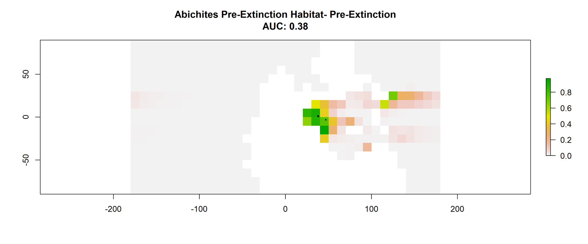

# Did oxygen and temperature control the distribution of marine ectotherms in the build up to the end Permian mass extinction?

An investigation into which environmental variables dictated the distribution of marine ectotherms in the aftermath of the end-Permian mass extinction using the maxent niche model.

## Contents
- [About the Project](#about-the-project)
- [Built With](#built-with)
- [Data and Cleaning](#Data-and-Cleaning)
- [Calculating and Mapping the Metabolic Index](#Calculating-and-Mapping-the-Metabolic-Index)
- [The Prediction Model](#The-Prediction-Model)
- [Results](#Results)

---

## About the Project

252 million years ago "the great dying" occurred killing 81% of marine species and 70% of all terrestrial species. There is little debate on the cause of this mass extinction, geological records provide substantial evidence of the Siberian traps erupting for 2 million years. However, whilst the geological evidence gives us an understanding of the mechanisms of the extinction it can't tell us the physiological reaction of species. This project attempts to bridge the gap between the geological and physiological to give a better understanding of the reaction of marine species to the immense change in climate.

## Built With
[R](https://www.r-project.org/)
[Maxent](https://biodiversityinformatics.amnh.org/open_source/maxent/)
[cGENIE](https://www.seao2.info/mymuffin.html)
[Panoply](https://www.giss.nasa.gov/tools/panoply/)
[ggplot2](https://ggplot2.tidyverse.org/)
[dplyr](https://dplyr.tidyverse.org/articles/dplyr.html)
[tidyr](https://tidyr.tidyverse.org/)

---

## Data and Cleaning

70,000 marine fossils from the paleobiology database were made into a .csv file. A column for paleorotation was added, and the data was filtered for the desired marine occurrences. The data included lots of N/A cells as well as inconsistent naming, dplyr and tidyr were used to make the dataset more uniform and fit for purpose. Finally the data was split into different dataframes based on the age of the fossils as we are investigating distribution before and after the mass extinction event.

## Calculating and Mapping the Metabolic Index

The metabolic index is a framework to determine an organisms metabolic tolerance to surrounding environmental parameters. Environmental parameters for the fossil occurrences were predicted by the cGENIE earth model. Oxygen, slainity and temperature are needed to calculate the oxygen partial pressure. The oxygen partial pressure was used alongside, temperature, the Boltzmann constant and phylum reference physiological limits. The aim is to calcualate a phylum's metabolic index for the whole end-Permian globe and use that as a predictor for distribution, comparing it to oxygen and temperature to see if its more effective. 

## The Prediction Model

Maxent is a machine learning model based on the principle of maximum entropy. It uses presence absence data and environmental variables to predict the distribution of species, it is commonly used in conservation and climate change research. However, the model is not limited to this research area, with applications in natural language processing, computer vision and modelling neural network firing patterns.

## Results

Before running analysis I had to test for and resolve col-linearity to allow the model to better predict based on the variables we want to understand. This exposed an issue that I had to rectify down the line, oxygen and temperature \(two variables we wanted to investigate independently\) were collinear. 

By modelling the environmental conditions at each fossil location we predicted their distribution before and after the end-Permian mass extinction. The Maxent model gives us the permutation importance of each genera which allows us to compare how much each variable influenced the distribution of marine ectotherms and therefore the physiological pressure that impacted them most.

The models were also ran without the important col-linear variables.

